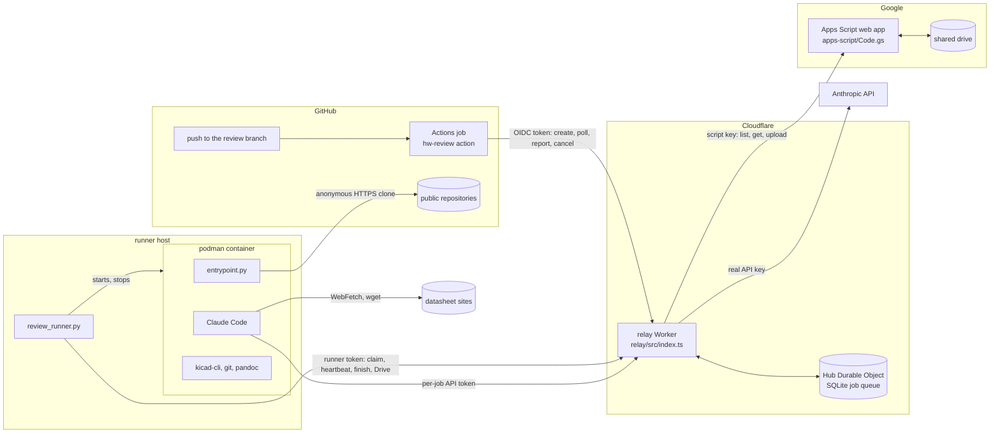
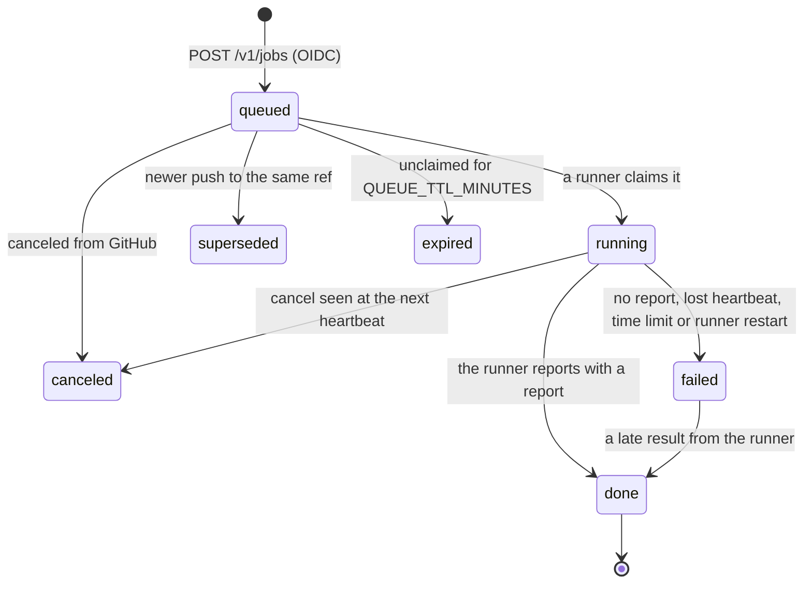

# Architecture

## Components

Who holds which credential:

| Credential | Held by | Grants |
|---|---|---|
| GitHub OIDC token | the Actions job (minted per request, minutes long) | create and read jobs of that one repository |
| `RUNNER_TOKEN` | relay, runner host | claim jobs, report results, Drive for the claimed job |
| per-job API token | relay (hash only), runner, container | the Anthropic API through the relay, while its job runs |
| `ANTHROPIC_API_KEY` | relay | the Anthropic API |
| `APPS_SCRIPT_KEY` | relay, Apps Script | the Drive bridge, inside its `ALLOWED_ROOTS` |

## Job states

## One review over time

A typical push; times are illustrative.

```mermaid
gantt
    dateFormat HH:mm
    axisFormat %H:%M
    section GitHub job
    submit, poll every minute      :g1, 00:00, 62m
    artifact and summary           :g2, after g1, 1m
    section Relay job
    queued                         :q, 00:00, 1m
    running                        :r, after q, 61m
    section Runner
    claim, Drive download          :d, 00:01, 1m
    container                      :c, after d, 59m
    docx upload, finish            :f, after c, 1m
    section Container
    clone repository and libraries :e1, 00:02, 2m
    ERC, DRC, exports              :e2, after e1, 3m
    Claude Code review             :e3, after e2, 53m
    run record, docx               :e4, after e3, 1m
```

## Files

- `relay/`: the Worker (`src/index.ts` routes, `src/hub.ts` queue, `src/oidc.ts` token
  check, `src/config.ts` settings) and its tests, including the relay in workerd.
- `runner/`: the host runner, its example config and the systemd installer.
- `container/`: the image (`Containerfile`), the entrypoint, the review prompts, the
  helper tools and the KiCad library map.
- `action/`: the composite GitHub action and an example board workflow.
- `apps-script/`: the Drive bridge and its manifest.
- `tests/`: Python tests, the stand-ins for podman and claude, the end-to-end test and
  the image smoke test.
